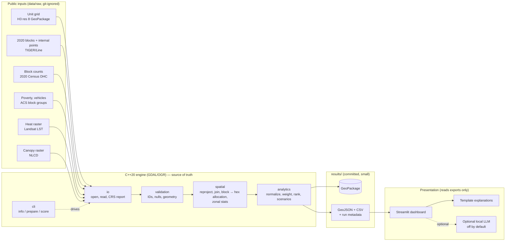

# Architecture

## Boundaries

- **Engine ↔ presentation:** the contract is the exported file schema (`docs/results_contract.md`,
  Week 18). The dashboard never recomputes indicators or normalization.
- **AI:** receives only structured result records and methodology text; it never produces numbers
  that are displayed as data. The app works identically with AI disabled.

- **Unit of analysis:** any polygon layer + ID field named in config. v1 uses an H3 res 8 grid
  generated once in Python (`scripts/make_h3_grid.py`); the C++ engine has no H3 dependency.
- **Population allocation (ADR 0003):** `spatial` assigns each 2020 block to the unit containing its
  internal point and splits ACS block-group counts to blocks by population share. The block layer,
  ID, and population fields come from config, so allocation works for any unit layer.

## Module responsibilities

| Module | Owns | Must not |
|---|---|---|
| `io` | Opening datasets, metadata, writing outputs | Contain analysis logic |
| `validation` | Quality checks and reports | Modify data silently |
| `spatial` | CRS transforms, joins, zonal statistics | Know about weights |
| `analytics` | Normalization, scoring, scenarios | Do file I/O |
| `cli` | Argument parsing, logging, exit codes | Contain calculations |
