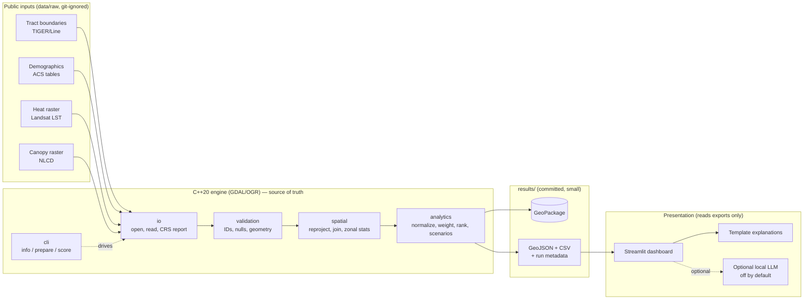

# Architecture

## Boundaries

- **Engine ↔ presentation:** the contract is the exported file schema (`docs/results_contract.md`,
  Week 18). The dashboard never recomputes indicators or normalization.
- **AI:** receives only structured result records and methodology text; it never produces numbers
  that are displayed as data. The app works identically with AI disabled.

## Module responsibilities

| Module | Owns | Must not |
|---|---|---|
| `io` | Opening datasets, metadata, writing outputs | Contain analysis logic |
| `validation` | Quality checks and reports | Modify data silently |
| `spatial` | CRS transforms, joins, zonal statistics | Know about weights |
| `analytics` | Normalization, scoring, scenarios | Do file I/O |
| `cli` | Argument parsing, logging, exit codes | Contain calculations |
