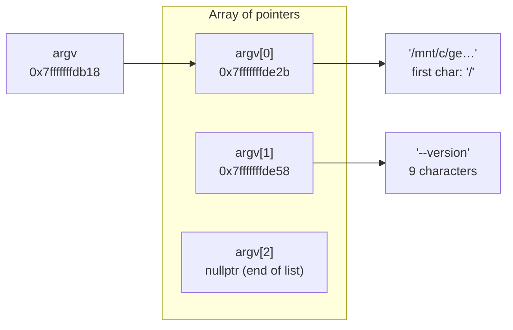

# C++ pointers: reading `argv` in the debugger

**Date:** 2026-11-27
**Project step:** Week 3, Task 2 (debugger setup)
**Topic:** pointers, `argv`, and following addresses

## Summary

While stepping through `georesilience --version` in the VS Code debugger, the
Variables panel showed `argv` as a hex number like `0x7fffffffdb18`. That number
is a memory address. `argv` points to an array of pointers, and each of those
points to a piece of text (one command-line argument).

## Diagram

Addresses are from one debugger run and change between runs. The structure
stays the same.

## How to read it

| Expression | Meaning | In this run |
|---|---|---|
| `argv` | address where the array starts | `0x7fffffffdb18` |
| `*argv` | `argv[0]`, the address of the first string | `0x7fffffffde2b` |
| `**argv` | first character of that string | `'/'` (code 47) |

## What I learned (my words)
Passing arguments to main lets users specify a set of options to guide the operation of the program. argc passes the number of strings in the parameters (2 in this case) and argv, the second parameter, is an array of pointers to C-style character strings. argv points to a char*. The element after the last pointer is always 0, NULL, to indicate the end of the list. argv[0] contains the programs name while argv[1] is where the optional argument begins.

## Open questions

-